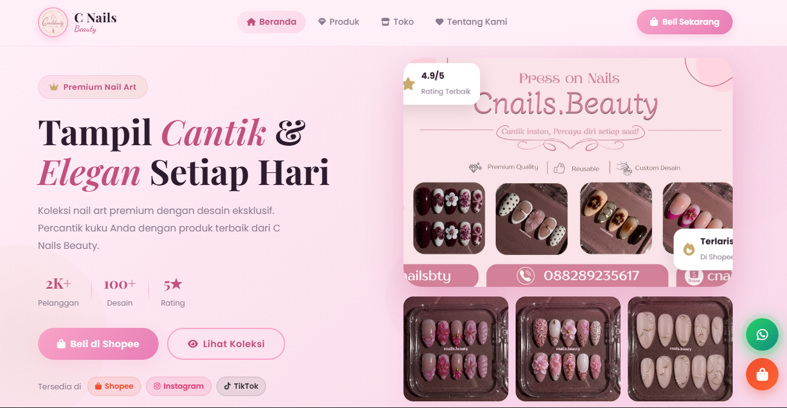
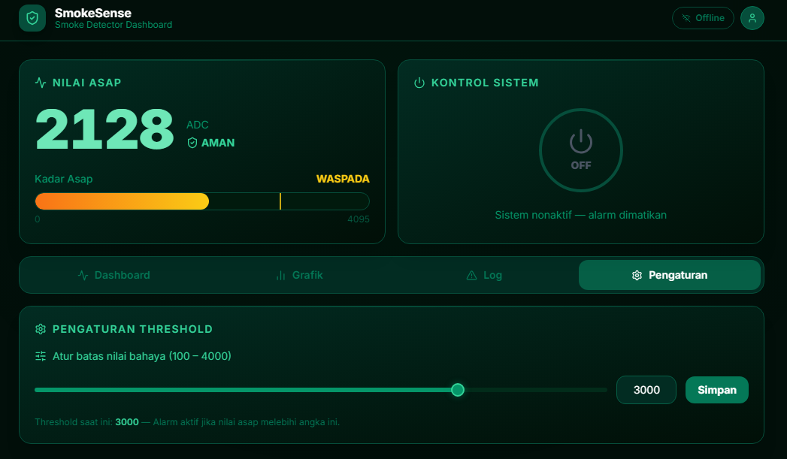
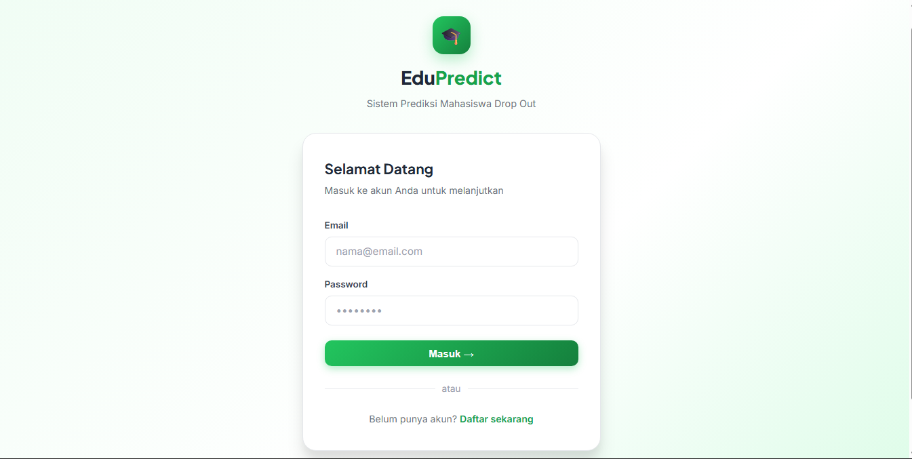

 

  

&nbsp;

  

 

## 01 — About Me

I'm **Adi Rahmat**, a developer and freelancer interested in building practical digital products with clean interfaces and reliable functionality.

My interests span web development, mobile applications, backend engineering, databases, and data analysis. I enjoy learning through hands-on experimentation and turning ideas into useful applications.

- Building applications that solve practical problems.
- Developing APIs and database-driven systems.
- Exploring mobile development and modern web technologies.
- Strengthening problem-solving and software engineering skills.
- Open to suitable freelance opportunities and collaborations.

 

> *"Good software is built with intention, not just code."*

---

## 02 — Technology & Tools

**LANGUAGES**

  
  
  
  
  

**FRAMEWORKS & RUNTIME**

  
  
  
  
  

**DATABASES & TOOLS**

  
  
  
  
  
  

---

## 03 — Selected Projects

### 01 / CNails Beauty

*A beauty website experience.*

 

  

### 02 / Smoke Detector

*A web-based smoke detection project.*

 

  

### 03 / EduPredict

*An education-focused prediction application.*

 

  

---

## 04 — GitHub Insights

  

---

## 05 — Current Focus

 Improving coding practices and application architecture.

 Building practical and user-friendly applications.

 Developing reliable APIs and database-driven systems.

 Exploring data mining and predictive approaches.

---

## 06 — Contact & Collaboration

I'm open to meaningful collaborations, development opportunities, and freelance projects that match my skills and interests.

Interested in working together? Explore my projects and repositories to learn more about what I build.

&nbsp;

  

 

uphoqrstu.id · Crafted with curiosity and code.

